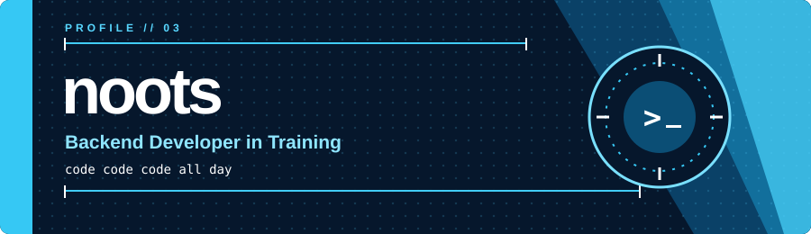

<div align="center">




</div>

## Profile

```text
NAME      noots
ROLE      CS Student
FOCUS     Learning backend and database fundamentals
MOTTO     code code code all day
```

I am a CS student exploring backend development through small projects and hands-on practice. I am currently learning Java, Spring Boot, PostgreSQL, Next.js, and TypeScript.

### Currently learning

- Java and Spring Boot fundamentals
- REST API concepts
- PostgreSQL and database basics
- Flyway database migrations
- Next.js and TypeScript
- Git and Docker basics

## Activity

<div align="center">

<a href="https://github.com/Noootnoot343"></a>


</div>

## Connect

<div align="center">

[](https://github.com/Noootnoot343)

</div>
