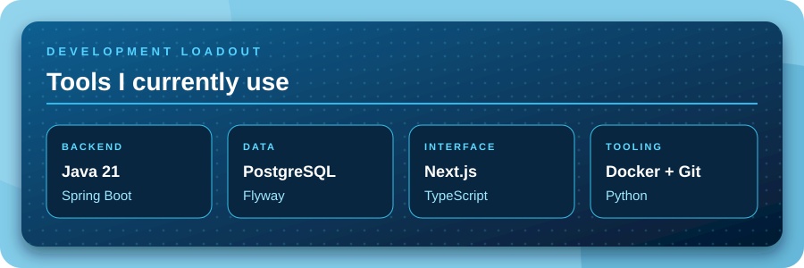
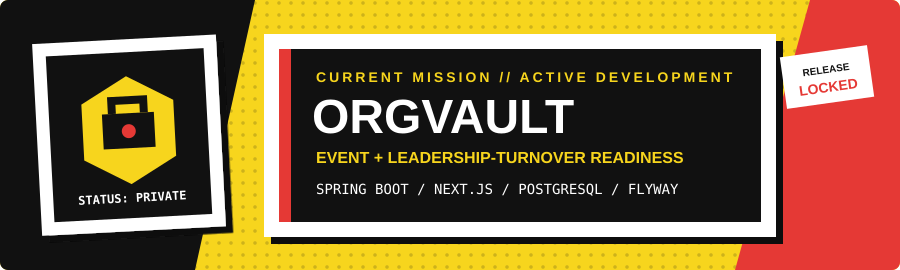
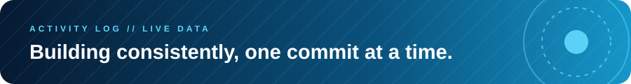

<div align="center">


</div>

## Profile

```text
NAME      noots
ROLE      IT Student / Aspiring Backend Developer
FOCUS     Backend fundamentals and database-driven applications
MOTTO     code code code all day
```

I am learning backend development by building projects and improving them one feature at a time. I currently work with Java, Spring Boot, PostgreSQL, Next.js, and TypeScript.

### What I can do now

- Build basic REST API endpoints with Spring Boot
- Store and query application data with PostgreSQL
- Manage database changes with Flyway migrations
- Connect a Next.js interface to backend endpoints
- Use Git, Docker, and local development tools for project work

## Development Loadout

<div align="center">




</div>

## Current Build

<div align="center">



</div>

**OrgVault** is an operational-readiness system for student organization events and leadership turnover.

- Models event preparation and turnover requirements as explicit, explainable rules
- Preserves organizational knowledge across changing leadership teams
- Uses Spring Boot, Next.js, PostgreSQL, and Flyway
- Remains private while it is under active development

## Activity

<div align="center">




</div>

## Connect

<div align="center">

[](https://github.com/Noootnoot343)

</div>
