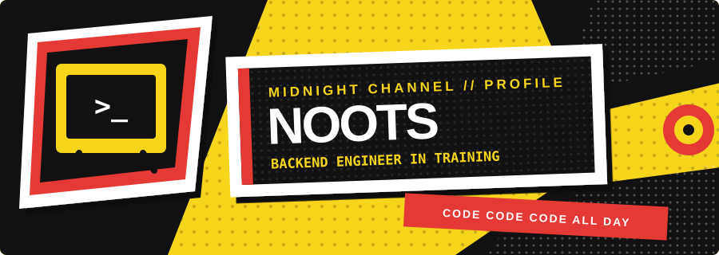

<div align="center">




</div>

## SOCIAL LINK // ABOUT

```text
NAME      noots
ROLE      Aspiring Backend Engineer
FOCUS     Reliable systems, clean architecture, useful products
MOTTO     code code code all day
```

I build systems from the database outward. My current work explores backend architecture, deterministic business rules, operational workflows, and the interfaces that make them useful.

> The truth is in the implementation.

## SKILL CARD // LOADOUT

<div align="center">


</div>

| Core | Building With | Engineering Interests |
| :--- | :--- | :--- |
| Java, Spring Boot | Next.js, TypeScript | API and domain design |
| PostgreSQL, Flyway | Python, Docker | Rule-based systems |
| Git, REST APIs | Full-stack workflows | Maintainability and product thinking |

## CURRENT MISSION // ORGVAULT

<div align="center">


</div>

**OrgVault** is an operational-readiness system for student organization events and leadership turnover.

- Models event preparation and turnover requirements as explicit, explainable rules
- Preserves organizational knowledge across changing leadership teams
- Uses Spring Boot, Next.js, PostgreSQL, and Flyway
- Remains private while it is under active development

## BATTLE STATS // ACTIVITY

<div align="center">


</div>

## OPEN A CHANNEL

<div align="center">

[](https://github.com/Noootnoot343)

</div>
